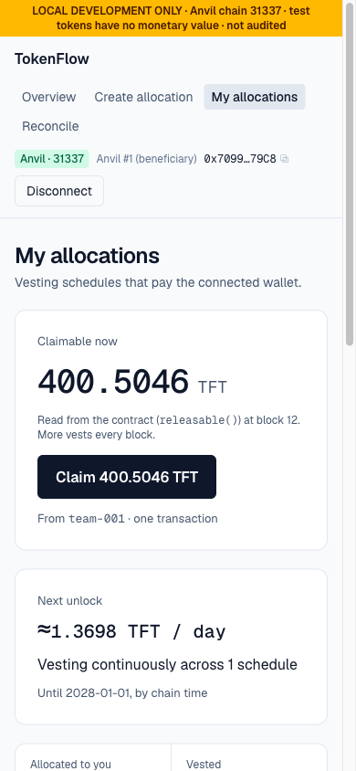

# TokenFlow

A developer-first **token allocation operations dashboard**: create and fund vesting schedules, let beneficiaries
claim, index contract events into Postgres, and **reconcile a CSV of expected allocations against on-chain state**,
with every report pinned to a specific indexed block.

> ⚠️ **Local and testnets only.** This portfolio prototype runs on a local Anvil chain (`31337`) by default, or on
> Sepolia / Base Sepolia with one setting (see [Networks](#networks)). Its test token has **no monetary value**, it is
> **not audited**, and mainnets are refused by design. Never import a real seed phrase or private key.


## Screenshots

| | |
|---|---|
| **Overview** (issuer)<br>Key figures tagged by source (live contract vs. indexed), a 12-month unlock projection that flags cliff spikes, indexer health and the last reconciliation. | [](docs/images/overview.png) |
| **Create allocation**<br>Validation as you type, exact raw units, a preview of the vesting curve, and an Approve → Create → Indexed transaction stepper. | [](docs/images/create-allocation.png) |
| **My allocations** (beneficiary)<br>Claimable amount read live from the contract, next unlock, per-schedule progress with cliff and today markers, and claim history. | [](docs/images/my-allocations.png) |
| **Reconcile: validate**<br>Per-line CSV validation before anything is compared; invalid and duplicate rows are reported, never dropped. | [](docs/images/reconciliation-validate.png) |
| **Reconciliation report**<br>Pinned to an indexed block: status filters, row detail with a field-by-field comparison and a suggested next step, CSV export. | [](docs/images/reconciliation-report.png) |
| **Mobile**<br>Every screen works at phone width. | [](docs/images/my-allocations-mobile.png) |

Screenshots come from a local Anvil chain with the seed data plus a few allocations created through the UI.

## Features

- **Vesting contract** (`contracts/src/VestingRegistry.sol`). Linear vesting with a cliff, funded atomically at
  creation, role-gated creation, beneficiary-only claims. Built with Foundry and OpenZeppelin 5.7.
- **Local or testnet, one setting.** `NETWORK=local | sepolia | base-sepolia` switches the chain, wallets, explorer
  links and safety rails; mainnets are refused ([Networks](#networks)).
- **Wallet flows.** Anvil dev accounts locally (no keys in the browser) or any browser wallet. You see every
  transaction state (preparing, awaiting signature, pending, confirmed, failed, rejected), plus wrong-network and
  disconnected states.
- **Overview, create and recipient views.** Key figures tagged by source (live contract vs. index), a 12-month
  unlock projection, a create form with a schedule preview and transaction stepper, and per-schedule claim progress.
- **Idempotent indexer.** Events are keyed by `(chain_id, tx_hash, log_index)`, each batch is one transaction, and the
  indexer can be replayed or restarted safely. It detects chain resets and, on testnets, waits for a confirmation
  depth before indexing.
- **Reconciliation.** CSV validation, exact integer amounts, and statuses for matched, amount / beneficiary /
  schedule mismatch, missing on-chain, on-chain-only, duplicate, invalid, and "can't verify yet (indexer behind)".
  Reports can be exported as CSV. On public networks, saving a report needs a schedule manager's wallet signature.

## Networks

The same build runs against one network profile, chosen with `NETWORK` in `apps/web/.env.local`:

| `NETWORK` | Chain | Wallets | Safety rails |
|---|---|---|---|
| `local` (default) | Anvil `31337` | Anvil dev accounts or a browser wallet | Everything runs on your machine |
| `sepolia` / `base-sepolia` | Sepolia `11155111` / Base Sepolia `84532` | Visitor's browser wallet | 3-block confirmation depth, signed report saves (schedule managers only), per-IP rate limits, explorer links, security headers |

Mainnets have no profile and are blocked in both the app and the deploy script. To deploy to a testnet (encrypted
keystore, Etherscan verification, configuration), follow [docs/deployment.md](docs/deployment.md).

## Prerequisites

| Tool | Tested with |
|---|---|
| Node.js | 22 LTS |
| pnpm | 12 (`corepack enable` or `npm i -g pnpm`) |
| Foundry (`forge`, `anvil`) | 1.8.5: `curl -L https://foundry.paradigm.xyz \| bash && foundryup` |
| PostgreSQL | 16 (e.g. `brew install postgresql@16 && brew services start postgresql@16`) |
| Git | any |

## Quick start

```bash
git clone --recurse-submodules https://github.com/robiul-shagor/TokenFlow.git tokenflow && cd tokenflow
pnpm install

# Databases (local Postgres; uses your OS user by default)
createdb tokenflow && createdb tokenflow_test
cp apps/web/.env.example apps/web/.env.local     # local, non-secret defaults
pnpm db:migrate
```

Then use three terminals:

```bash
# 1. Local chain
pnpm chain                       # anvil on http://127.0.0.1:8545, chain 31337

# 2. Contracts + demo data (once per fresh chain), then the indexer
pnpm contracts:deploy            # MockERC20 + VestingRegistry → contracts/deployments/31337.json
pnpm contracts:seed              # 4 demo schedules
pnpm indexer                     # polls every 2s; Ctrl-C to stop

# 3. Web app
pnpm dev                         # http://localhost:3000 (pnpm dev -p 3100 if 3000 is busy)
```

Deploy and seed use Anvil's **unlocked** default account (`--unlocked --sender`), so no private key is needed or
stored anywhere.

## Demo walkthrough

1. **Overview.** Key figures (each tagged contract or index), a 12-month unlock chart, indexer health, the last reconciliation, and the seeded allocations with live claimable amounts.
2. **Connect** with *Anvil #1 (beneficiary)* → **My allocations** → **Claim** `seed-001`, which is fully vested.
   Watch pending → confirmed, then the indexer updates "Claimed".
3. Connect *Anvil #0 (issuer/admin)* → **Create allocation**, for example `ops-001` for
   `0x15d34AAf54267DB7D7c367839AAf71A00a2C6A65`, 120 TFT, start `2026-01-01 00:00` UTC, 0-day cliff, 365 days.
4. **Reconcile.** Download `allocations.example.csv` (everything matches the seed) or `allocations.with-issues.csv`
   (every status), upload it, run it, and export the report.

The sample CSVs refer to the token at `0x5FbDB2315678afecb367f032d93F642f64180aa3`, which is where a deploy as the
first transaction on a fresh Anvil puts it. Vesting progress follows Anvil's clock, which is wall-clock time unless
you start Anvil with `--timestamp`.

### Using a browser wallet instead

Create a **development-only** browser profile and add a network with RPC `http://127.0.0.1:8545` and chain ID
`31337`. Import one of the disposable private keys **printed by your local `anvil`**. Never use those keys on a public
network, and never import a real wallet into this setup.

## Commands

| Command | What it does |
|---|---|
| `pnpm chain` | Start Anvil |
| `pnpm contracts:build` / `contracts:test` | `forge build` / `forge test` (unit, fuzz, invariant) |
| `pnpm contracts:deploy` / `contracts:seed` | Local deploy and demo data on Anvil |
| `pnpm contracts:deploy:sepolia` / `:base-sepolia` | Testnet deploy with an encrypted keystore and Etherscan verification ([guide](docs/deployment.md)) |
| `pnpm db:migrate` | Apply SQL migrations (`apps/web/drizzle/`) |
| `pnpm indexer` | Run the indexer worker. Flags: `--once`, `--reset` |
| `pnpm dev` / `pnpm build` | Next.js dev server / production build |
| `pnpm test` | Vitest: unit, component, and Anvil + Postgres integration tests |
| `pnpm lint` / `pnpm typecheck` | ESLint / `tsc` |

## Troubleshooting

- **"Setup incomplete"** in the UI: Anvil isn't running or contracts aren't deployed. Run `pnpm chain`, then
  `pnpm contracts:deploy`. On a testnet, check `NETWORK`, `RPC_URL` and the manifest; `/api/health` names any
  missing setting.
- **Indexer: "chain was reset"** after restarting Anvil: the local chain starts from scratch, so redeploy and seed,
  then run `pnpm indexer --reset`.
- **"Indexed data may be out of date"**: start `pnpm indexer`. Reports created while it is behind are marked stale.
- **Port 3000 in use**: run `pnpm dev -p 3100`.

## Repository layout

```text
contracts/            Foundry project (src/, test/, script/, deployments/<chainId>.json; the local one is git-ignored)
apps/web/             Next.js app: UI, API routes, indexer (src/indexer, scripts/indexer.ts), Drizzle schema + migrations
sample-data/          Example reconciliation CSVs
docs/                 architecture, threat model, testing report, ADRs, case study, requirements
.github/workflows/    CI: forge fmt/lint/build/test; web lint/typecheck/test/build with Postgres + Anvil; gitleaks
```

## Documentation

- [Architecture](docs/architecture.md) · [Threat model](docs/threat-model.md) · [Testing report](docs/testing.md) ·
  [Deploying to a testnet](docs/deployment.md)
- [Requirements](docs/requirements.md) · [Case study](docs/case-study.md)
- Decisions: [vesting contract](docs/decisions/0001-vesting-contract.md) ·
  [ORM](docs/decisions/0002-orm-and-database.md) · [dev wallet](docs/decisions/0003-local-dev-wallet.md) ·
  [indexer](docs/decisions/0004-indexer.md) · [reconciliation](docs/decisions/0005-csv-reconciliation.md) ·
  [network profiles](docs/decisions/0006-network-profiles.md)

## Disclaimer

A self-directed portfolio prototype. No independent audit or formal verification has been performed. Test tokens
have no value. Deploy only to the supported testnets, and never use it with real funds.
