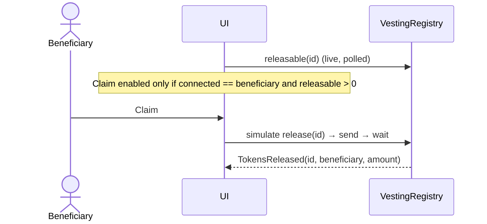
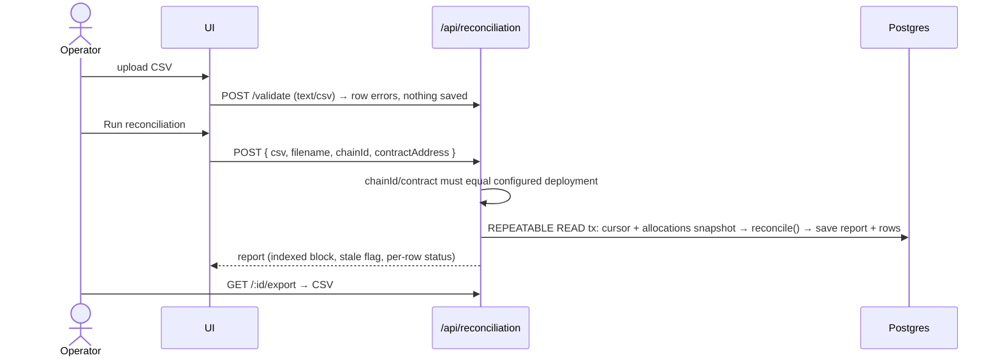

# Architecture

TokenFlow is a local-only portfolio prototype. Everything runs on one machine: Anvil (chain `31337`), PostgreSQL,
a Next.js app and an indexer worker.

```text
Browser (Next.js client components)
  ├── wagmi + viem ─────────── reads (releasable, balances) + writes (create, approve, release)
  │                                         │
  └── fetch /api/* ──► Next.js route handlers                       ▼
                         ├── /api/allocations, /api/activity   Anvil RPC :8545 (chain 31337)
                         ├── /api/health                         ├── MockERC20 (TFT, test token)
                         └── /api/reconciliation/*               └── VestingRegistry
                                 │                                      │ events
                                 ▼                                      ▼
                           PostgreSQL ◄──────── indexer worker (pnpm indexer, polls every 2s)
                             indexed_events, allocations (read model),
                             indexer_cursors, reconciliation_reports/_rows
```

## Components

| Component | Location | Responsibility |
|---|---|---|
| `VestingRegistry` | `contracts/src/VestingRegistry.sol` | Source of truth: schedules, funding, vesting maths, claims, access control |
| `MockERC20` | `contracts/src/mocks/MockERC20.sol` | Freely mintable test token (no monetary value) |
| Deploy/seed scripts | `contracts/script/` | Local-only (refuse any chain ≠ 31337); write `contracts/deployments/31337.json` |
| Web UI | `apps/web/src/app/` | Dashboard, create allocation, recipient claims, reconciliation |
| Server config | `apps/web/src/server/config.ts` | Loads and validates the manifest; fails closed on unsupported chains |
| Indexer | `apps/web/src/indexer/`, `scripts/indexer.ts` | Idempotent event ingestion into Postgres |
| Reconciliation | `apps/web/src/lib/{csv,reconcile}.ts`, `src/server/reports.ts` | Pure CSV validation and diffing; persisted reports |

## Rules (from the plan) and how they are enforced

1. **The contract is authoritative.** "Claimable" always comes from `releasable()` (`useReadContracts`), and writes are
   simulated against the contract before they are sent. `scheduleState()` in the UI is a display label only.
2. **The DB is a read model.** Every API response that uses indexed data includes `indexedBlock`, `headBlock` and
   indexer state, and the UI shows a warning when the data is stale.
3. **The indexer is restartable and replay-safe.** See [ADR 0004](decisions/0004-indexer.md).
4. **Integer token units everywhere.** Solidity `uint256`, TypeScript `bigint`, Postgres `NUMERIC(78,0)`. Values are
   formatted only at render time (`formatTokenAmount`).
5. **CSV input is untrusted.** See [ADR 0005](decisions/0005-csv-reconciliation.md).
6. **No private keys anywhere.** Scripts and the dev connector use Anvil's unlocked accounts
   ([ADR 0003](decisions/0003-local-dev-wallet.md)).
7. **Local config is separate.** The manifest is generated and git-ignored, and `.env.example` holds only local
   non-secret defaults.

## Sequence: issuer creates an allocation

```mermaid
sequenceDiagram
  actor Issuer as Issuer (Anvil #0)
  participant UI as Next.js UI
  participant RPC as Anvil
  participant VR as VestingRegistry
  participant IDX as Indexer
  participant DB as Postgres
  Issuer->>UI: fill form → Review (client-side validation)
  UI->>RPC: read allowance / hasRole
  alt allowance < amount
    UI->>RPC: simulate + send approve(registry, amount)
  end
  UI->>RPC: simulate createSchedule(...)
  UI->>RPC: eth_sendTransaction(createSchedule)
  RPC->>VR: createSchedule → transferFrom(issuer → registry)
  VR-->>RPC: ScheduleCreated, ScheduleFunded
  UI->>RPC: waitForTransactionReceipt → "confirmed"
  IDX->>RPC: getLogs(cursor+1..head)
  IDX->>DB: tx { insert events ON CONFLICT DO NOTHING; project allocations; move cursor }
```

## Sequence: beneficiary claims



## Sequence: operator reconciles a CSV



## Data model

See `apps/web/src/db/schema.ts` and the migration `apps/web/drizzle/0000_init.sql`.

- `indexed_events`: unique `(chain_id, transaction_hash, log_index)`, plus the block hash, decoded JSON payload and
  decoded allocation id.
- `allocations`: primary key `(chain_id, contract_address, allocation_id_hex)`. Holds the beneficiary, amounts and
  schedule as exact numerics, plus the creating block and tx.
- `indexer_cursors`: primary key `(chain_id, contract_address)`. Holds the last processed block and its hash, the
  last run time and the last error.
- `reconciliation_reports` / `reconciliation_rows`: each report records chain, contract, token, decimals, indexed
  block, head block and stale flag. Rows record per-row status and message.

## API

| Method | Path | Notes |
|---|---|---|
| GET | `/api/health` | Status of manifest, DB, RPC and indexer (503 if a dependency is down) |
| GET | `/api/allocations[?beneficiary=0x…]` | Indexed allocations plus indexing metadata |
| GET | `/api/activity?limit=&before=` | Paginated indexed events, newest first |
| POST | `/api/reconciliation/validate` | `text/csv` body, max 1 MB. Returns file and row errors without saving |
| POST | `/api/reconciliation` | JSON `{csv, filename?, chainId, contractAddress}`. Both must match the configured deployment |
| GET | `/api/reconciliation[?limit=]` | Recent report summaries |
| GET | `/api/reconciliation/:id` | Full saved report |
| GET | `/api/reconciliation/:id/export` | CSV export |
| GET | `/api/reconciliation/sample?variant=example\|issues` | Sample files from `sample-data/` |
