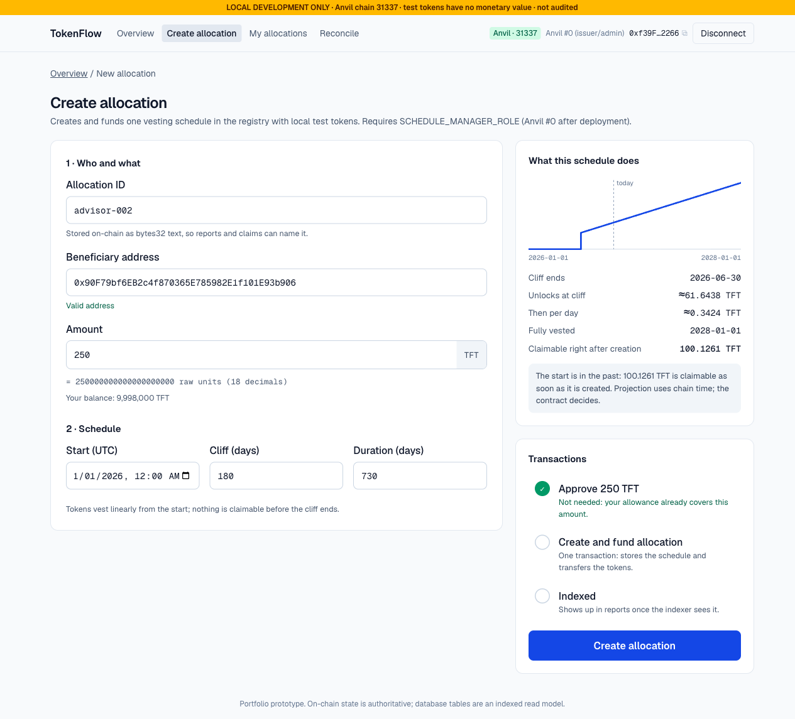
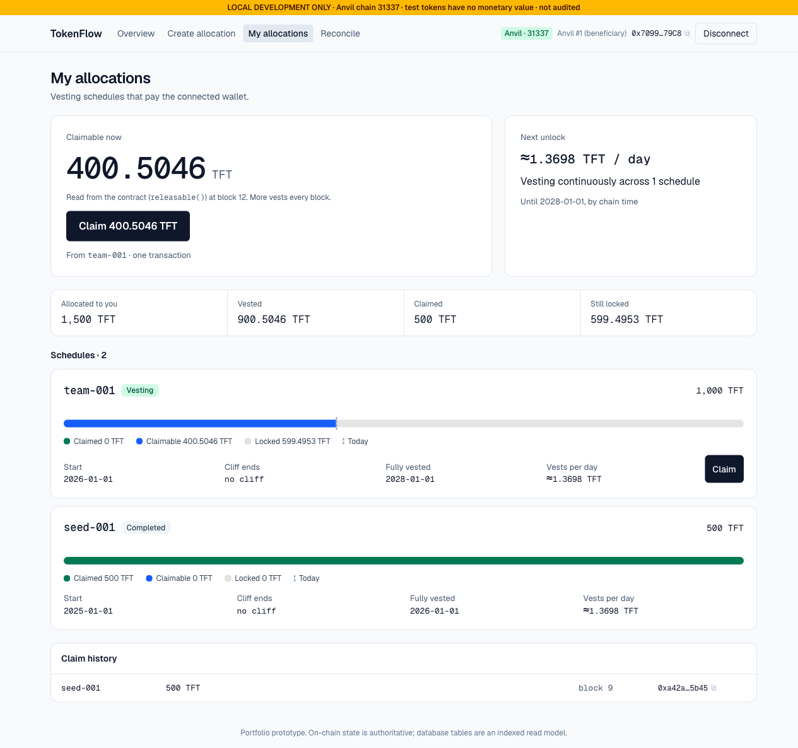
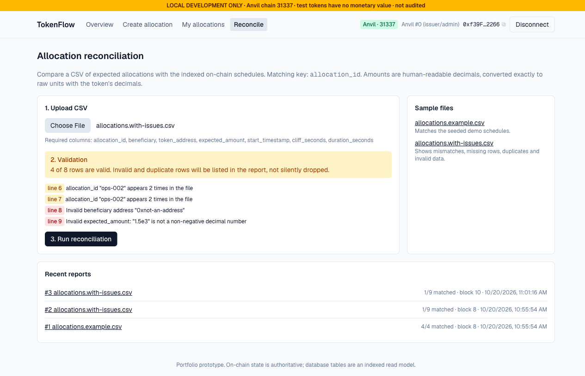
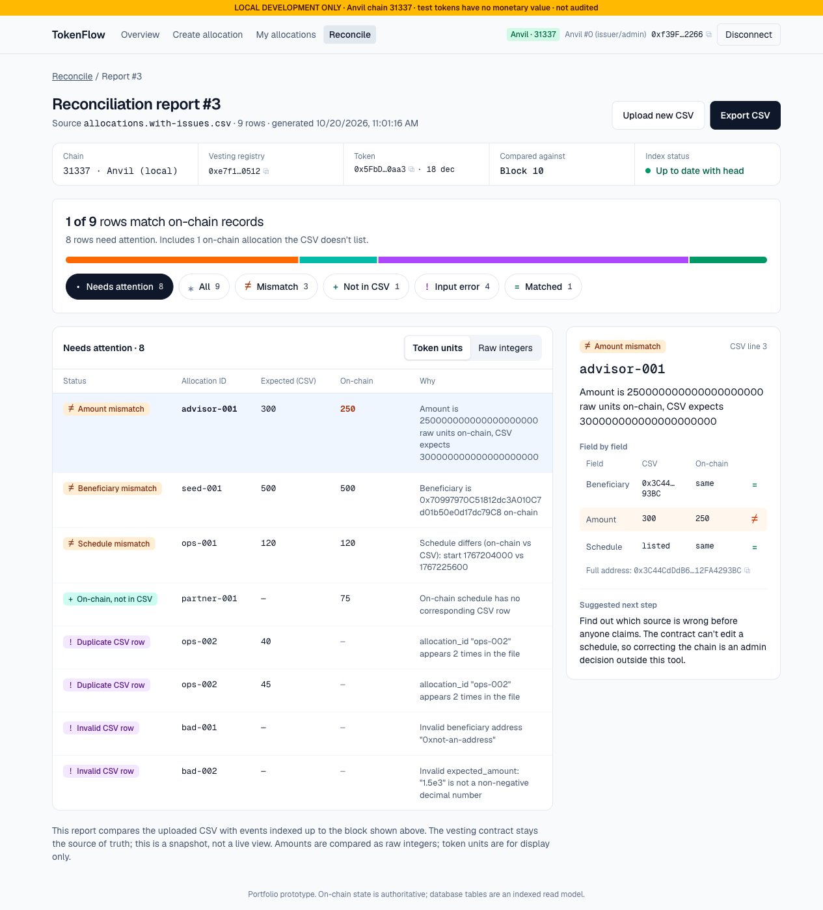
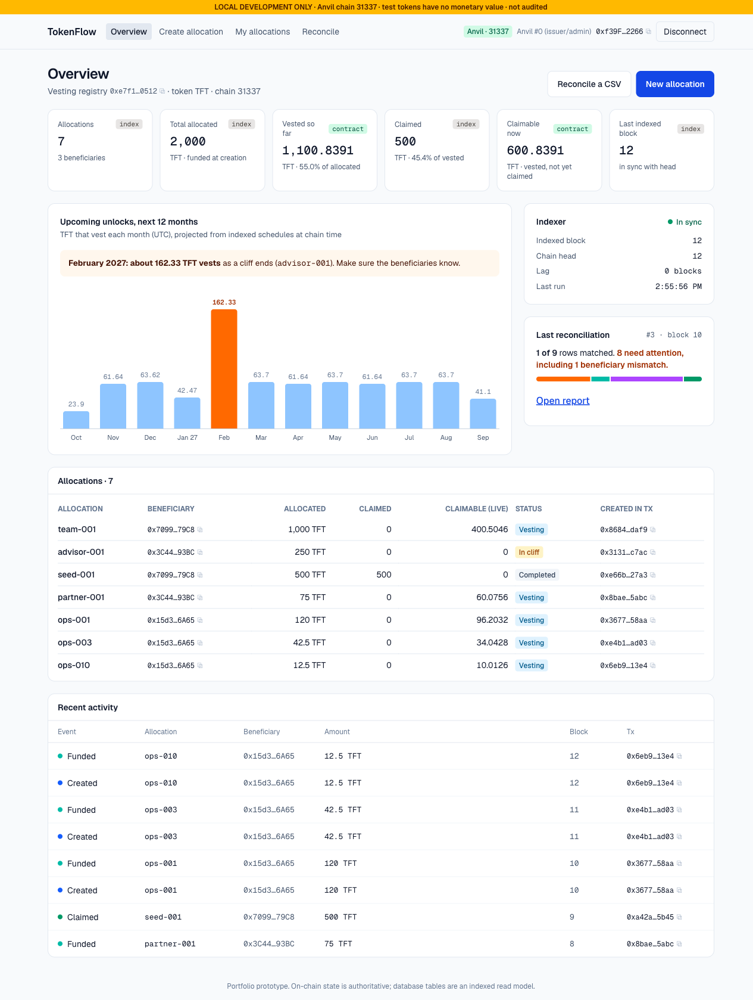

# Case study: TokenFlow

> **Self-directed portfolio project.** A prototype that runs on a local Anvil chain or a public testnet (Sepolia,
> Base Sepolia), with test tokens that have no monetary value. Not audited, not production software, not client work.

## 1. Overview

TokenFlow is a developer-first dashboard for token allocation operations. An issuer creates and funds vesting
schedules, beneficiaries claim what has vested, and an operator **reconciles a CSV of expected allocations against
on-chain state**, with every report tied to a specific indexed block.

## 2. Problem

Token allocations usually live in two places: a spreadsheet the team trusts, and contracts that actually hold the
tokens. They drift apart. Amounts get typed wrong, beneficiaries get swapped, schedules are created in the wrong
timezone, rows get duplicated, and some allocations are never created at all. Explorers show raw events but don't
answer "does the chain match our cap table, as of which block?"

## 3. Role and scope

I designed and built everything (contracts, indexer, API, UI, tests, CI, docs) as a solo portfolio project. Scope is
deliberately limited to local and test networks: no mainnet and no real funds. On public networks, writes are
authorised by on-chain roles rather than accounts and passwords.

## 4. User journeys

1. **Issuer** (Anvil #0) creates an allocation: live validation and a schedule preview, then simulate → send →
   confirmed → indexed.
   
2. **Beneficiary** (Anvil #1) claims a fully vested schedule. The claimable amount comes straight from the contract.
   
3. **Operator** uploads a CSV, sees validation per line, then a report with row-level explanations.
   
   

## 5. Architecture

Next.js 16 + wagmi 3 / viem 2 in the browser, Next route handlers for the API, PostgreSQL with Drizzle as a read
model, a polling indexer worker, and Foundry/Anvil for contracts. Details and sequence diagrams are in
[architecture.md](architecture.md).

## 6. Contract decisions

OpenZeppelin's `VestingWallet` is one contract per beneficiary, its allocation is "whatever balance is there", and it
has no external identifier. That makes reconciliation ill-defined. TokenFlow instead uses a ~150-line
`VestingRegistry` built on OpenZeppelin `AccessControl`, `SafeERC20` and `ReentrancyGuard`. Schedules are keyed by
`allocationId` and funded atomically, fee-on-transfer tokens are rejected, and the linear-with-cliff boundaries are
tested exactly. See [ADR 0001](decisions/0001-vesting-contract.md).

## 7. Engineering challenges (real, from this build)

1. **Reconciliation caught a timezone bug in my own UI.** The create form first read `datetime-local` in the
   browser's timezone. A schedule created on a UTC+6 machine came out 6 hours off, and the next reconciliation
   flagged it as `schedule_mismatch: start 1767204000 vs 1767225600`. The fix makes the form explicitly UTC, to match
   the CSV's unix timestamps, and adds a regression test. That is exactly the class of drift the tool is meant to
   surface.
2. **The indexer stopped catching up early.** viem caches `getBlockNumber`, so a batched catch-up after several new
   blocks thought it was at head after 2 batches instead of 7. An integration test found it, and the fix is to read
   the head with `cacheTime: 0`.
3. **Hydration and wallet state.** The connector `uid`s are random, so server-rendered `<option value>`s didn't match
   the client and "connect" silently did nothing. Separately, wallet status differs between SSR and the browser.
   The fix uses stable connector ids and renders wallet-dependent UI only after mount.
4. **No keys, anywhere.** Deployment, seeding and the in-browser dev wallet all use Anvil's *unlocked* accounts
   (`--unlocked --sender`, and `eth_sendTransaction` through a wrapped wagmi `mock` connector). The repo contains no
   private key, and the browser never holds one.

## 8. Testing

24 Foundry tests (unit, 2×1000-run fuzz, 4 invariants over 16,384 random calls) with 100% line and branch coverage
of `VestingRegistry`, plus 83 Vitest tests including 6 Anvil + Postgres integration tests (replay, retry,
catch-up, chain reset). Commands, outputs and Slither results are in [testing.md](testing.md).

## 9. Reconciliation example

Input: `sample-data/allocations.with-issues.csv`, run against the seeded chain plus one schedule created from the UI.

| Line | Allocation | Status | Explanation |
|---|---|---|---|
| 2 | team-001 | Matched | Beneficiary, amount and schedule match |
| 3 | advisor-001 | Amount mismatch | 250 TFT on-chain, CSV expects 300 |
| 4 | seed-001 | Beneficiary mismatch | On-chain beneficiary is Anvil #1 |
| 5 | ops-001 | Schedule mismatch | start 1767204000 vs 1767225600 (the timezone bug above) |
| 6–7 | ops-002 | Duplicate CSV row | Appears twice; both rows are excluded from matching |
| 8 | bad-001 | Invalid row | Invalid beneficiary address |
| 9 | bad-002 | Invalid row | `1.5e3` is not a plain decimal |
| — | partner-001 | On-chain, not in CSV | No corresponding CSV row |

The report header stated chain 31337, the registry address, and indexed block 10 = chain head (not stale).

## 10. Security and limitations

See [threat-model.md](threat-model.md). In short: local Anvil or public testnets only (mainnets refused), single EOA
admin, reorgs handled by a confirmation depth (deeper ones stop the indexer for a manual reset), report saving
authorised by an on-chain role signature on public networks, no revocation, one token per registry, not audited.

## 11. Results (verifiable)

- Issuer → beneficiary → claim → index → reconcile works end to end on a fresh Anvil, as shown in the screenshots
  above and the integration test.
- 27/27 contract tests and 111/111 web tests pass. `VestingRegistry` has 100% line and branch coverage.
- The testnet profile was exercised against a simulated Sepolia chain (deploy, indexer with confirmations, signed
  report saves, rate limits); see [testing.md](testing.md). A real Sepolia deployment is the next step.
- Lint, typecheck and production build are clean.

No user counts, client impact or performance claims are made.

## 12. Future work

A live Sepolia deployment, automatic reorg rollback (instead of stop-and-reset), multisig admin (Safe), storing the
signer of each report, a strict Content-Security-Policy, multi-token support, a committed Playwright suite, and an
independent security review.

## 13. Links

- Repository: _add after publishing_
- Demo video (2–3 min): _to be recorded. Keep the "LOCAL DEVELOPMENT ONLY" / "TESTNET DEMO" banner visible._
